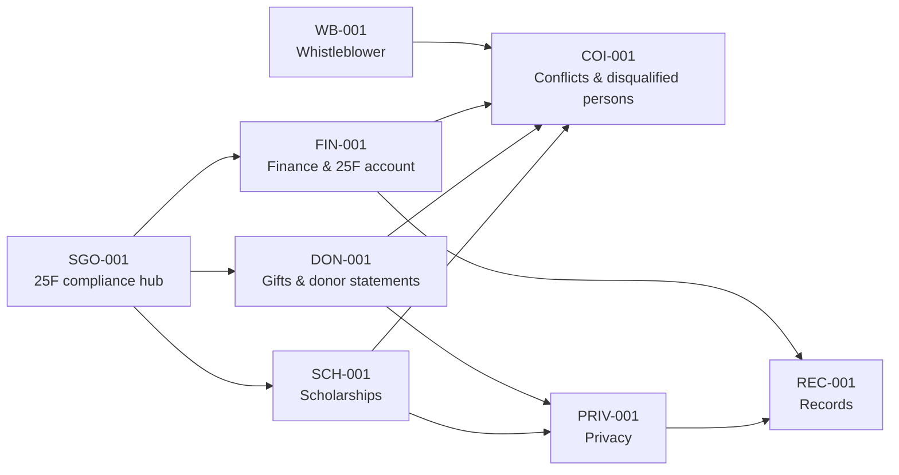

# TENNISSA Policy and Procedures Manual

**Tennessee Islamic School Scholarship Alliance, Inc.** · Policy repository

 

This repository contains TENNISSA's governing policies. TENNISSA is a Tennessee nonprofit preparing to operate as a **scholarship granting organization (SGO)** under the federal scholarship tax credit (IRC § 25F). It funds need-based K–12 scholarships at qualifying Islamic schools in Tennessee.

> ⚠️ **Draft. Not yet adopted.** Version 5.0 revises Version 4.0 following a legal-compliance review (see [REVIEW-NOTES.md](REVIEW-NOTES.md)). It takes effect only after review by Tennessee nonprofit counsel and a CPA, and adoption by the Board using [board-adoption-resolution.md](board-adoption-resolution.md). Nothing in this repository is legal or tax advice.

## Policies

| # | Policy | ID | Owner |
|---|---|---|---|
| 1 | [Scholarship Policy](policies/01-scholarship-policy.md) | TENNISSA-SCH-001 | Executive Director |
| 2 | [Financial Controls Policy](policies/02-financial-controls-policy.md) | TENNISSA-FIN-001 | Financial Controller Director |
| 3 | [Records Retention and Destruction Policy](policies/03-records-retention-policy.md) | TENNISSA-REC-001 | Records Custodian |
| 4 | [Whistleblower and Reporting Policy](policies/04-whistleblower-policy.md) | TENNISSA-WB-001 | Board Chair |
| 5 | [Donor Acceptance and Gift Restrictions Policy](policies/05-donor-acceptance-policy.md) | TENNISSA-DON-001 | Executive Director |
| 6 | [Privacy and Confidentiality Policy](policies/06-privacy-confidentiality-policy.md) | TENNISSA-PRIV-001 | Privacy Officer |
| 7 | [Conflict of Interest Policy](policies/07-conflict-of-interest-policy.md) | TENNISSA-COI-001 | Board Chair |
| 8 | [Section 25F SGO Compliance and Reporting Policy](policies/08-section-25f-compliance-policy.md) *(new)* | TENNISSA-SGO-001 | Compliance Director |

Supporting documents:

- [REVIEW-NOTES.md](REVIEW-NOTES.md): findings, reasons for each change, Board decisions D1–D9, and sources
- [CHANGELOG.md](CHANGELOG.md): version history
- [board-adoption-resolution.md](board-adoption-resolution.md): fill-in adoption resolution

## Repository layout

```
.
├── README.md
├── REVIEW-NOTES.md
├── CHANGELOG.md
├── board-adoption-resolution.md
├── .github/
│   └── pull_request_template.md
└── policies/
    ├── 01-scholarship-policy.md
    ├── 02-financial-controls-policy.md
    ├── 03-records-retention-policy.md
    ├── 04-whistleblower-policy.md
    ├── 05-donor-acceptance-policy.md
    ├── 06-privacy-confidentiality-policy.md
    ├── 07-conflict-of-interest-policy.md
    └── 08-section-25f-compliance-policy.md
```

## How the policies fit together



## Relationship to the Bylaws

These policies supplement TENNISSA's Articles of Incorporation and Bylaws. If they conflict, applicable law controls first, then the Articles and Bylaws, then these policies. Provisions that depend on the Bylaws:

- **Bylaws §4.4, Founding Directors.** The three Founding Directors hold continuing seats. COI-001 §§8 and 14 and WB-001 §4 explain how conflicts and complaints involving founders are handled without relying on the other founders.
- **Officers (Article VII).** The Executive Director, Compliance Director and Financial Controller Director roles named here should match the officer titles in the Bylaws.

## Changing a policy

Policies are changed only by Board resolution. This repository is the working record of proposed and adopted text.

1. **Branch.** Create a branch such as `policy/sch-001-income-verification`.
2. **Edit.** Change only the policy file(s) involved. Update the header table (version, status) and add an entry to `CHANGELOG.md`.
3. **Pull request.** Open a PR using the template. Explain the reason (a law change, an audit finding or an operational need) and tag the policy owner.
4. **Review.** Changes touching scholarships, donors, Section 25F, compensation or conflicts need sign-off from counsel and/or the CPA, recorded in the PR.
5. **Board adoption.** Merge to `main` **only after** the Board adopts the change. Put the resolution number and date in the merge commit and the CHANGELOG, then tag the release (e.g. `v5.1`).

`main` always holds the most recently **adopted** text. Drafts stay in branches or PRs.

### Versioning

- **Major (6.0):** the whole manual is re-adopted or a policy is added or removed.
- **Minor (5.1):** a substantive change to one or more policies.
- **Patch (5.1.1):** typo, link or formatting fixes with no change in meaning. The Executive Director may approve these and report them to the Board.

## Annual cycle

| Month | Task |
|---|---|
| January | Annual conflict-of-interest statements (COI-001 App. A); Section 25F donor statements by Jan 31 |
| February | Section 25F contribution report by Feb 28 |
| Spring | Independent audit; Form 990 with Section 25F information |
| June | Tennessee charitable solicitation renewal (calendar-year filers) |
| Before each award cycle | School reverification; publish criteria |
| Q4 | Board reviews **all policies** and updates this repository |

See [SGO-001 §4](policies/08-section-25f-compliance-policy.md#4-annual-compliance-calendar) for the full calendar.

## Confidentiality of this repository

The policies themselves can be made public, and posting them builds donor trust. **Never commit** applications, donor lists, income documents, signed disclosure forms or any other personal data to this repository. Keep the repository **private** until the Board adopts the policies.

## Disclaimer

These documents are governance policies for TENNISSA. They are not legal, tax or financial advice to any donor, family or school. Donors should consult their own tax advisers about the Section 25F credit.

---

© Tennessee Islamic School Scholarship Alliance, Inc. · <https://tennissa.org> · info@tennissa.org
